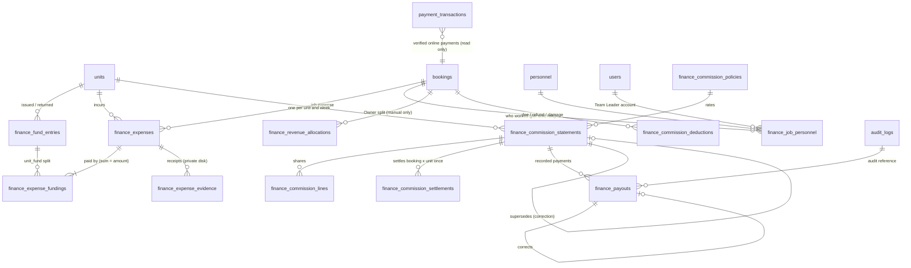

# Owner Finance Module — Programmer Handoff (staging / demo review)

Branch `feat/owner-finance` (worktree `TowMate_wt_finance`, created from `origin/main` @ `47383fcb`). **Not pushed, not deployed.**
Details and test evidence for every phase are in [progress.md](progress.md); the specification is in [spec.md](spec.md).

## 1. Status in one paragraph

All confirmed requirements are implemented, database-backed and tested:
- unit funds
- expenses (Team Leader → Dispatcher → Owner, private receipts, Team Leader app screen)
- jobs and verified collections
- crew recording
- the commission calculation
- weekly statements (Draft → For Review → Approved → Paid)
- payout records
- Overview, Reports and exports
- an isolated demo and a Client Review register

The commission *interpretation* is still the client's decision. The real policy v1 is "Draft / Pending Client Confirmation", so **no real statement can be approved and no real payout can be recorded** until a programmer records the client's confirmed answers (section 7). The demo shows the full flow using a clearly labelled demo stand-in policy that the code refuses to use outside a `*_demo` database.

## 2. Database

Eight migrations, applied in order (all additive; no existing table is altered destructively):

| Migration | Adds |
|---|---|
| `2026_11_10_000000_create_owner_finance_tables` | 9 core tables, CHECK constraints, partial unique indexes, immutability triggers, draft policy v1 |
| `2026_11_11_000000_add_unit_fund_details_to_finance_fund_entries` | issue kind, external reference, correction link |
| `2026_11_12_000000_expenses_review_and_mixed_funding` | `finance_expense_fundings`, expense scope and coverage month, shortfall, correction link, approval trigger |
| `2026_11_13_000000_jobs_collections_allocations` | allocation total and notes, `manual_split` method |
| `2026_11_14_000000_create_finance_commission_deductions` | `finance_commission_deductions` |
| `2026_11_15_000000_commission_statements_and_crew_recording` | crew confirmation and supersede reasons, per-unit statements, review step, `finance_commission_settlements` |
| `2026_11_16_000000_payout_records_and_paid_statements` | payout evidence and correction link, Paid status and reconciliation trigger |
| `2026_11_17_000000_create_finance_client_review_items` | Client Review register and the 11 standard pending decisions |

### ERD

`bookings`, `units`, `personnel`, `users`, `payment_transactions`, `invoices` and `audit_logs` are existing tables that are read (never copied). `finance_client_review_items` stands alone.

**Integrity is enforced in PostgreSQL, not only in PHP:**
- No deletes on financial rows; voids and corrections instead.
- Frozen columns; allowed status transitions only.
- One current crew position per booking × unit × slot.
- One open statement per week × unit.
- One active settlement per booking × unit.
- One recorded payout per statement × recipient.
- An approved statement can't have an unallocated amount.
- "Paid" only when recorded payouts equal the statement's personnel amount.
- Payouts of a Paid statement can't be voided.

## 3. Screens, routes and permissions

All Owner screens are under `/superadmin/finance` (route group `role:1`) and each route also has a `can:` Gate. **Every service method re-checks the Gate**, so a new controller cannot skip it.

| Screen (sidebar) | Route | View / write ability |
|---|---|---|
| Finance Overview | `GET /superadmin/finance` | `finance.view` |
| Jobs & Collections | `/jobs-collections`, `POST …/{booking}/split` | view / `finance.revenue.allocate` |
| Unit Funds | `/unit-funds`, `POST issuances, returns, {entry}/correct, {entry}/void` | view / `finance.funds.manage` |
| Expenses | `/expenses`, `POST` create, approve, reject, correct, void, evidence | view / `finance.expenses.submit`, `finance.expenses.approve` |
| Job Crew | `/job-crew`, `/job-crew/{booking}`, `POST` record, correct, remove, confirm | view / `finance.crew.manage` |
| Commission (Draft) | `/commission`, `POST deductions…` | view / `finance.deductions.manage` |
| Commission Statements | `/commission-statements` (list, new, show, print, pdf), `POST` store, recalculate, submit, return, approve, void, correct | view / `finance.statements.prepare`, `finance.statements.approve` |
| Payout records (on the statement page) | `POST …/{statement}/payouts`, `…/mark-paid`, `/payouts/{id}/void`, `/correct`, `GET /payouts/{id}/evidence` | `finance.payouts.record` |
| Finance Reports | `/reports`, `/reports/print`, `/reports/pdf`, `/reports/excel` | `finance.view` (downloads rate-limited, prefix `finance-exports`) |
| Client Review | `/client-review`, print, pdf, `POST` store, update | view / `finance.policies.manage` |
| Finance Demo (demo database only, else 404) | `/demo`, `POST /demo/reset` | view / `finance.policies.manage` (limit 3 per 10 min, prefix `finance-demo-reset`) |
| Dispatcher: Expense Review | `/admin-dashboard/expense-review` (verify, reject) | `finance.expenses.verify` (Dispatcher only) |
| Team Leader app | `GET/POST /api/v1/team-leader/expenses`, `…/options`, `…/{id}/evidence` | `finance.expenses.submit` (own unit only) |

Every Owner-only ability (`finance.view`, `funds.manage`, `expenses.approve`, `policies.manage`, `statements.prepare/approve`, `payouts.record`, `revenue.allocate`, `deductions.manage`, `crew.manage`) requires an active, non-archived Owner account (`App\Support\Finance\FinanceAccess`).

**Integrations with existing code (read-only unless stated):**
- Booking and payment data: `bookings.completed_at` = Dispatcher-verified payment; live non-demo PayMongo payments.
- Invoice group rules: `Invoice::sameTripMembers`.
- The document generator: `DocumentGenerationService::renderReportPdf`.
- The spreadsheet injection guard: `ReportWorkbookBuilder::safeText`.
- Audit log categories: `AuditLogService`.
- Two existing-code changes:
  - `UnitController::forceDelete` refuses units with finance history (Phase 1).
  - `ReportMetricsService::revenueSummary` counts grouped-trip "Cash Received" once per trip (Phase 8 defect fix).

## 4. Calculation and reconciliation rules (as implemented)

- **Money:** `App\Support\Money` (bcmath strings; floats refused; half-up to the centavo). Database sums use `NUMERIC`.
- **Verified collection** (`JobCollectionService`): a Dispatcher payment confirmation (`completed_at`) covering the agreed charge, or a live non-demo PayMongo payment. The preferred method, cash tendered, TEST, pending and failed payments never count. A group trip is one job (one booking, N vehicles); its cash is counted once.
- **Unit allocation:**
  - Automatic per vehicle only when fully paid and every vehicle has its own unit.
  - Partly paid jobs, or jobs another unit helped on, stay "pending review" until the Owner records a split that totals exactly.
  - No automatic 50:50.
- **Unit fund ledger:** opening (everything before the period) + issued − approved unit-fund expense splits − returned = remaining. Funds are not income and not expenses.
- **Sharing base per job × unit:** allocated verified collection − that unit's approved job expenses (all categories and funding sources, each once) − that unit's approved deductions.
- **Shares:**
  - Each policy percentage applies to the same base (60 / 12 / 10 / 10 / 8).
  - Rounding is half-up per share; the remainder goes to Company, so Company + crew + unallocated = base exactly.
  - A role nobody held stays unallocated.
  - People come only from the Owner's crew records for that job and unit.
- **Baseline:** 15,000 − 2,950 = 12,050 → Company 7,230; Driver 1,446; Team Leader 1,205; Rider 1,205; Crew Mate 964; crew 4,820. The 50.00 return does not affect the base.
- **Approval requires** an active client-confirmed policy, zero blockers, and an unchanged recalculation. The blocker codes are listed in progress.md, Phases 5 and 6.
- **Approval writes** a sha256-hashed snapshot and the settlements.
- **Payouts:** one full payout per person, amount from the snapshot, reference or evidence required. Paid only when reconciled exactly.

## 5. Demo setup and reset

1. Create an empty PostgreSQL database whose name ends with `_demo` (for example `towmate_finance_demo`).
2. Copy `.env.demo.example` to `.env.demo` (git-ignored). Set `APP_KEY`, the database credentials and `FINANCE_DEMO_PASSWORD`. Mail goes to the log and PayMongo keys stay blank.
3. Run `php artisan finance:demo-reset --env=demo --force`. It drops and rebuilds the demo database, builds the six scenarios and prints the sign-in.
4. Serve it: `APP_ENV=demo php artisan serve --port=8010` (or a staging host with `APP_ENV=demo`).
5. Sign in as `demo.owner@towmate.test` (Dispatcher: `demo.dispatcher@towmate.test`; Team Leaders: `demo.tl1…8@towmate.test`), all with `FINANCE_DEMO_PASSWORD`.
6. Reset any time: Finance → Finance Demo → type `RESET DEMO`, or rerun the command.

The reset refuses unless `FINANCE_DEMO_ENABLED=true`, `APP_ENV` is not production, and the real database name ends with `_demo`. **Never enable it on a database with real records.**

## 6. Owner usage guide (short)

1. **Every day:** issue funds to units (Unit Funds → Issue funds); record returns when cash comes back.
2. **Expenses:** Team Leaders submit from the app with a receipt; the Dispatcher verifies; you approve or reject (Expenses). Approved unit-fund expenses reduce that unit's cash.
3. **After each completed job:** check Jobs & Collections. Record a split when a job is "allocation pending review". Record who actually worked it (Job Crew → Open → Record a participant, choosing the role performed).
4. **Weekly (Monday–Saturday):** Commission Statements → Prepare a statement → choose the week, unit and jobs → Calculate → review the blockers → Submit for review → Approve (only possible once the client has confirmed the policy).
5. **Pay people outside TowMate** (cash, GCash, bank), then record each payout on the statement with its reference or evidence → Mark statement Paid. A mistake: Correct (void and replace) before marking Paid.
6. **Reports:** Finance Reports → filters → Print / Save as PDF or Download Excel.
7. **Client decisions:** Client Review → record the client's answer and status. Answering never changes a rule; ask the programmer to implement it.

## 6b. Client demonstration checklist (about 30 minutes)

Before the meeting: run the demo reset, sign in as the demo Owner, and open Finance → Finance Demo. The red banner confirms you are on demo data.

1. [ ] **Overview** (last week): ₱74,550 verified collections, ₱7,500 outstanding. Point out that actual money, the draft estimate, approved commission and payouts are shown separately.
2. [ ] **Jobs & Collections:** the three-vehicle booking counts as 1 booking and 3 vehicles (₱15,000 once); the partial payment shows ₱7,500 of ₱15,000; the two-unit job shows "allocation pending review".
3. [ ] **Unit Funds,** Unit 1: ₱3,000 issued − ₱2,950 spent − ₱50 returned = ₱0.
4. [ ] **Expenses:** receipts on each approved expense; the ₱2,000 personal advance; one Team Leader expense waiting. Switch to the Dispatcher account and verify it, then approve it as the Owner.
5. [ ] **Job Crew:** Unit 2 has no Rider. Show how the actual crew is recorded and corrected with a reason.
6. [ ] **Weekly Commission (Draft):** baseline 12,050 → 7,230 / 4,820; Unit 2 shows 1,205 unallocated and its blockers.
7. [ ] **Commission Statements:** Unit 1 is Approved with its frozen snapshot and hash. Record the two remaining simulated payouts, then Mark statement Paid. Open the printable statement and download the PDF.
8. [ ] **Finance Reports:** filter by Unit 1, then Print / Save as PDF and Download Excel; the totals match the screen.
9. [ ] **Client Review:** go through CR-001 … CR-011, the 50:50 proposal and the personal advance item. Record the client's answers and statuses, then download the summary PDF.
10. [ ] **Close:** explain that no real statement can be approved until the answers are implemented, and that TowMate never transfers money.

## 7. Remaining client decisions and what they block

Tracked as items CR-001 … CR-011 on the Client Review screen.

| Decision | Blocks |
|---|---|
| C1 sharing base (VAT, which expenses, fees/refunds) | Approval of every real statement |
| C2 shared roles (pool or per person) | Statements with two people in one role |
| C3 empty roles | Statements with a missing role |
| C4 Rider, substitute, combined roles | Statements with a Rider, substitute or combined role |
| C5 group / multi-unit splits (standard 50:50?) | Jobs helped by another unit |
| C6 corrections after approval; reopening Paid statements | Corrections of Paid statements |
| Week cutoff (service or payment date) and Sunday jobs | Commission for Sunday jobs and late payments |
| Monthly maintenance allocation | Statements for units with monthly expenses |
| Personal advance reimbursement | Statements with personal advances |
| Partial or group payouts | Anything other than one full payout per person |
| Refunds and provider fees | Jobs paid online or refunded |

**To enable real approvals after the client answers:**
1. Create a new policy version with `CommissionPolicyService::createDraft`.
2. Record the confirmed base, allocation rule and `confirmed_rules` with `confirmInterpretation`.
3. Activate it with `activate`.
4. Implement any rule that differs from the current provisional behaviour, with tests.

There is no screen for this on purpose.

## 8. Staging deployment notes

- **Migrations:** `php artisan migrate --force` applies the 8 additive migrations. Back up the database first.
- **Rollback:** each migration has a `down()` for development only. On a database with finance records, restore the backup instead; `down()` drops finance tables.
- **Environment:** `FINANCE_DEMO_ENABLED` must be unset or `false` on any real or staging database. Use a separate `*_demo` database for demos.
- **Private files:** receipts and payout evidence are stored on the `local` disk (`PRIVATE_STORAGE_ROOT`, default `storage/app/private`), served only through authorised routes. Direct `/protected-storage/...` URLs return 403 without a signed URL; this was verified on the demo server.
  - **On Railway the container filesystem is not persistent.** Set `PRIVATE_STORAGE_ROOT` to a mounted volume (or move the disk to object storage) before real receipts are uploaded.
- **Scheduled jobs and queues:** none are added by Finance. PDF and Excel are generated per request.
- **Flutter:** the Team Leader app gained an Expenses tab. The APK was not rebuilt in this work.

## 9. Verification summary and what remains unverified

See progress.md, Phase 11 acceptance matrix. In short:
- automated backend, Finance and Flutter suites pass
- 26 real browser interactions pass on the demo server, at desktop and 390 px phone width

**Unverified (manual):**
- the Team Leader expense screen on a physical phone or emulator (no device was available)
- printing through a physical printer or the browser's print dialog
- opening the Excel file in Microsoft Excel (it was re-opened with PhpSpreadsheet and validated as XLSX)
- running on the Railway staging host
